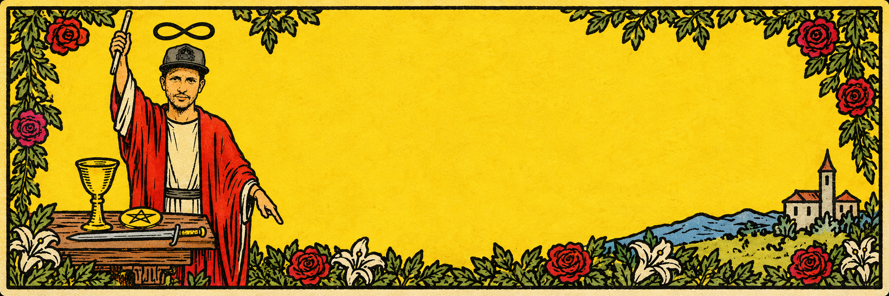

<!-- ========== BANNER ========== -->
<!-- Banner: la imagen vive en assets/banner.png (subí la carpeta assets al repo) -->

<!-- Texto animado: separá las frases con ; y los espacios con + -->

<!-- Badges de contador / redes -->

---

## Sobre mí

Soy **Federico**, 

- Desde **Puerto Madryn, Argentina**

---

## Tecnologías

**Lenguajes**

**Frameworks y librerías**

**Herramientas**

---

## Proyectos destacados

<!-- EDITAR: reemplazá cada imagen placehold.co por la captura real (subila al repo, por ej. a /assets, y usá la ruta relativa: assets/proyecto1.png) -->

<table>
  <tr>
    <td align="center" width="33%">
      
       <b>Proyecto 1</b>
       Descripción corta de qué hace.
       <code>Python</code> · <code>Flask</code>
    </td>
    <td align="center" width="33%">
      
       <b>Proyecto 2</b>
       Descripción corta de qué hace.
       <code>React</code> · <code>Tailwind</code>
    </td>
    <td align="center" width="33%">
      
       <b>Proyecto 3</b>
       Descripción corta de qué hace.
       <code>Node.js</code> · <code>Express</code>
    </td>
  </tr>
</table>

---

## Estadísticas de GitHub

---

## Contacto

<!-- Borrá las redes que no uses -->

